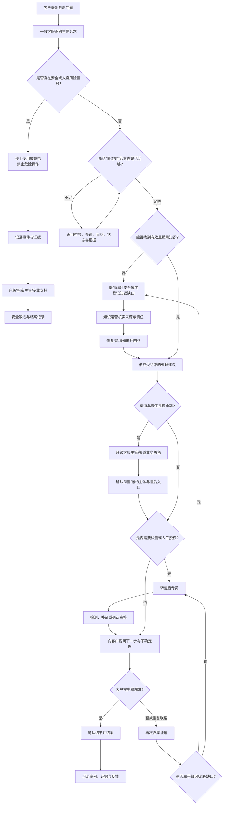

# 用户从咨询到结案或升级的现状旅程

日期：2026-10-22  
性质：基于公开售后资料和公开问法的模拟旅程，不是实际客服观察记录

## 1. 旅程假设

`[判断]` 一个售后请求通常不是“问一句、答一句”就结束，而是依次经过识别诉求、补齐上下文、查找规则、判断路径、沟通处理、确认结案等步骤。任何一步信息不足、规则冲突或风险升级，都可能改变后续路径。

本旅程用于需求验证，不代表某家企业的真实客服流程。

## 2. 主流程与分支

## 3. 阶段拆解

| 阶段 | 主要角色 | 当前动作 | 需要的信息或证据 | 常见断点 | 可能的升级 |
|---|---|---|---|---|---|
| 1. 客户发起 | 客户 | 用自然语言描述问题或情绪 | 用户表达、订单线索、产品线索 | 问法模糊、只说“坏了”或“发烫” | 需要客服追问 |
| 2. 识别诉求 | 一线客服 | 判断是使用、退货、换货、维修、渠道还是安全 | 型号、场景、症状、时间、风险信号 | 多个诉求混在一起；高风险信号被当成普通故障 | 安全/主管升级 |
| 3. 补齐上下文 | 一线客服 | 询问型号、渠道、日期、状态、凭证 | 商品身份、购买/签收时间、渠道、外观、使用条件 | 客户不知道渠道；信息散落在订单、发票和照片中 | 补充证据或售后专员接手 |
| 4. 查找规则与证据 | 一线客服 | 搜索文档、FAQ、SOP、渠道页面或找人询问 | 官方原文、渠道政策、内部 SOP、版本与有效期 | 相似内容多但适用条件不同；旧政策未失效 | 知识运营核实 |
| 5. 形成判断 | 一线客服/售后专员 | 判断适用路径和下一步 | 资格、例外、风险、责任主体和可执行动作 | 不敢承诺、错误承诺、不同人解释不同 | 售后、主管、业务/法务角色 |
| 6. 沟通与执行 | 一线客服/售后专员 | 解释规则、收集材料、预约检测或引导退货 | 对外表述、材料清单、渠道入口和服务单 | 客户不认可；渠道互相推诿；信息反复收集 | 投诉或渠道冲突升级 |
| 7. 结案或升级 | 售后专员/客服主管 | 确认问题是否解决、是否转其他责任方 | 结案标准、客户确认、服务记录、未决事项 | 没有统一结案标准；只看是否回复，不看是否解决 | 继续跟进或重新受理 |
| 8. 反馈与知识更新 | 知识运营/AI 评测 | 判断是否出现新问题、知识缺口或错误模式 | 原问题、检索证据、建议、处理结果和失败原因 | 反馈停在群聊或工单；无法定位应改哪条知识 | 新增知识、停用旧知识或回归 |

## 4. 四条关键异常路径

### 4.1 信息不足

触发：型号、渠道、时间、状态或证据缺失。

正确处理：先追问必要字段；在关键条件缺失时只提供安全、通用的下一步，不生成确定结论。

不可接受：用猜测补全客户信息，或把相似案例直接当成当前客户的处理结果。

### 4.2 安全风险

触发：冒烟、明火、异味、鼓包、异常发热、进液后通电、持续皮肤损伤等。

正确处理：停止使用/充电、避开危险操作、记录必要事实并升级。常规退换修判断应排在风险处置之后。

不可接受：继续追问优惠、保修或责任，而忽略即时风险；指导拆机、加热、吹风或继续充电。

### 4.3 渠道冲突

触发：订单、发票、序列号、实际销售主体和客户主张不一致。

正确处理：标记冲突，核验商品身份和销售/履约主体，按品牌与渠道各自角色处理，必要时升级主管或业务。

不可接受：没有证据即承诺品牌兜底，或把渠道结论当成品牌结论。

### 4.4 知识缺失

触发：公开资料无法回答；规则版本冲突；需要订单、诊断或内部授权才能判断。

正确处理：明确说明缺少什么，提供安全的临时下一步，登记缺口，指定责任角色并设置复核。

不可接受：编造规则、引用不相关文档、把过期资料当成有效证据。

## 5. 结案判定

模拟项目将“结案”分为以下可标记状态，不把它们等同于真实业务指标：

- `已给出可执行下一步`：建议包含明确动作和证据；
- `转人工待处理`：需要售后、主管、业务或专业支持；
- `信息待补齐`：必要上下文不足；
- `风险已升级`：安全风险已止损并转交；
- `知识缺口待修复`：已登记来源、影响范围和责任人；
- `已修复待回归`：知识或流程已修改，尚未验证；
- `模拟闭环`：原因、动作、责任角色、证据和回归均齐全。

`[限制]` 以上状态用于阶段 1A 的模拟验收，不构成阶段 2 状态机设计。

## 6. 旅程验证发现

`[判断]` 基于 30 条公开问法，当前旅程的主要断点不是“没有答案”，而是：

1. 用户表达往往不足以判断适用规则；
2. 规则文本与具体商品、渠道、时间和状态之间缺少映射；
3. 高风险问题容易被用户描述成普通“坏了”或“发热”；
4. 渠道责任与保修责任可能同时存在，不能用一个知识答案解决；
5. 错误处理没有稳定回流到知识和评测。

这些判断需要通过后续模拟标注验证，不能被表述为真实客户访谈结论。
