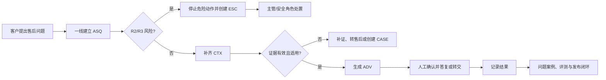

# 企业级 RAG 知识库平台产品需求文档（PRD）

> 历史版本：已被 V1.1 修订版替代，仅保留审计记录；当前评审请使用 [V1.1](01_企业级RAG知识库平台_PRD_V1.1.md)。

版本号：V1.0.0  
文档状态：评审稿，等待阶段验收  
日期：2026-10-23  
项目性质：公开资料驱动的模拟案例  
正式评测基线：阶段 1B `v1.1` 的 12 条人工确认核心任务

| 版本 | 日期 | 修订人 | 备注 |
|---|---|---|---|
| V1.0.0 | 2026-10-23 | AI 产品经理兼交付负责人 | 基于阶段 1B 有条件验收基线与阶段 2A 修正版创建正式 PRD |

## 一、背景与概述

### 1.1 背景

`[项目事实]` 本项目是公开资料驱动的模拟案例，不是 Apple 内部项目，也不声称获得真实客服访谈、客户订单、真实对话或业务结果。

模拟售后团队面对的问题不是缺少文档，而是需要在一线对话中组合：

- 商品、型号和身份证据；
- 实际销售、履约和服务渠道；
- 购买、签收、服务和时间关系；
- 商品完好、故障、进液、变形等状态；
- 官方规则、商业政策、保修合同和安全边界；
- 售后、主管、业务/渠道、知识运营、评测和安全/法务之间的责任。

`[判断]` 只提供一个通用文档问答工具，无法证明建议适用于当前客户，也无法阻止越权承诺和高风险漏升级。

### 1.2 产品概述

面向多渠道消费电子品牌的售后知识运营平台，在一线客服工作台内提供上下文补齐、有效证据、条件性处理建议和风险升级；在受控后台提供来源、知识版本、业务审核、问题案例、评测和发布管理。

### 1.3 产品目标

| 目标类型 | 目标 | 验收方式 |
|---|---|---|
| 产品目标 | 让 12 条正式核心任务得到可追溯、受约束的处理建议 | 12 条 GTW 验收全部通过 |
| 业务目标 | 为未来验证“有效售后问题解决率”建立可信基础 | 当前模拟阶段不计算真实业务值 |
| 风险目标 | 不发生 U1/U2 等高后果错误 | 所有高风险门禁与承诺边界测试通过 |
| 知识治理目标 | 来源、知识版本、发布和回滚职责可追溯 | 状态、权限、审计和回归测试通过 |
| 用户目标 | 一线能明确知道缺什么、能做什么、不能承诺什么、何时升级 | 核心任务行为验收通过 |

### 1.4 正式成功指标与模拟代理指标

#### 1.4.1 正式业务北极星指标

**有效售后问题解决率 = 经业务和人工记录确认已解决的售后问题数 / 已结案的售后问题数**

当前没有真实客户结案数据，不能在阶段 2B 计算该指标，也不能虚构目标值。

#### 1.4.2 模拟验收代理指标

| 指标 | 定义 | 验收意义 |
|---|---|---|
| 核心任务通过率 | 通过 GTW 验收的核心任务数 / 12 | 产品结构是否可执行 |
| 必需追问完整率 | 正确提出的必需字段 / 标注要求字段 | 是否识别上下文缺口 |
| 规则条件匹配率 | 正确使用关键条件的样本数 / 适用样本数 | 是否避免单一关键词回答 |
| 有效证据覆盖率 | 证据正确且版本有效的样本数 / 应有证据样本数 | 是否可追溯 |
| 安全升级召回率 | 正确升级的 R2/R3 样本数 / 全部 R2/R3 样本数 | 是否守住安全边界 |
| 不可接受错误逃逸率 | 未拦截的 U 类错误数 / 应拦截错误数 | 系统门禁是否有效 |
| 问题闭环完整率 | 具备原因、责任人、修复和回归证据的案例数 / 案例总数 | 知识治理是否闭环 |

### 1.5 目标用户

| 角色 | 核心诉求 |
|---|---|
| 一线客服 | 在对话中快速获得可执行且不越权的建议 |
| 售后专员 | 获得完整上下文、判断退换修和服务路径 |
| 客服主管 | 处理风险、冲突、发布和团队质量问题 |
| 业务/渠道负责人 | 确认政策口径、适用渠道和责任边界 |
| 知识运营 | 管理来源和知识版本，处理缺口并追踪闭环 |
| AI 评测人员 | 用冻结任务集验证动作、证据和风险 |
| 法务/安全责任人 | 处理法律、安全和高风险事件 |
| 系统管理员 | 管理权限和技术运行，不拥有业务发布权 |

### 1.6 非目标

- 不替代 CRM、订单、支付、物流和传统工单系统；
- 不让模型自动批准退款、赔偿、保修或法律结论；
- 不提供医疗诊断；
- 不做泛企业搜索；
- 不研发基础大模型、向量数据库或通用 RAG 引擎；
- 不建设多租户计费、插件市场或渠道分润；
- 不以文档数、切片数、会话数或模型参数量定义成功。

## 二、项目性质、证据边界与组织假设

### 2.1 模拟性质

- 不是 Apple 内部项目；
- 不暗示与 Apple 存在合作；
- AirPods Pro 3 只是公开资料和售后场景参考；
- 模拟企业不对外代表任何真实品牌；
- 所有场景、规则和结果必须标明来源类型。

### 2.2 证据等级

| 类型 | 用途 | 不能用于 |
|---|---|---|
| 公开事实 | 官方政策、法规、安全资料、服务与渠道信息 | 外推企业内部流程 |
| 模拟企业规则 | 角色交接、审批和风险责任 | 宣称为真实组织制度 |
| 产品团队假设 | 方案价值、采用方式和技术方向 | 宣称为已验证事实 |
| AI 预填样本 | 发现覆盖和需求线索 | 正式评测和对外结论 |

### 2.3 用户组织假设

| 角色 | 模拟职责 | 主要交接 |
|---|---|---|
| 一线客服 | 创建任务、补齐上下文、确认答复或升级 | 售后、主管、知识运营 |
| 售后专员 | 故障、退换修、检测和服务判断 | 主管、业务/渠道 |
| 客服主管 | 风险、冲突、任务质量和发布准备 | 安全/法务、业务、知识运营 |
| 业务/渠道负责人 | 政策口径、渠道责任和例外批准 | 知识运营、主管 |
| 知识运营 | 来源、知识版本、案例和发布执行 | 业务、评测、主管 |
| AI 评测人员 | 样本、回归、失败分类和评测证据 | 知识运营、主管 |
| 法务/安全责任人 | R3、法律和安全专业判断 | 主管、知识运营 |
| 系统管理员 | 配置、权限和技术执行 | 所有角色，但不能绕过审批 |

## 三、角色、职责分离与核心场景

### 3.1 角色权限摘要

完整矩阵见 [06_权限职责分离附录.md](06_权限职责分离附录.md)。

核心原则：

- 提交知识的人不能单独批准自己的知识；
- 知识运营不能代替业务/渠道负责人确认政策；
- AI 评测人员通过评测不等于批准政策；
- 一线客服不能单独关闭 R2/R3；
- 管理员不能绕过审核、评测或审计发布；
- 高风险问题优先于普通售后流程。

### 3.2 核心场景

12 条正式核心任务分为三组：

| 组别 | 核心任务 |
|---|---|
| 售后规则判断 | CORE-R1、CORE-R2、CORE-R3、CORE-R4 |
| 安全风险升级 | CORE-S1、CORE-S2、CORE-S3、CORE-S4 |
| 知识更新与问题闭环 | CORE-K1、CORE-K2、CORE-K3、CORE-K4 |

详细任务和 GTW 验收见 [04_核心任务GTW验收条件.md](04_核心任务GTW验收条件.md)。

### 3.3 端到端用户旅程



## 四、产品范围与 P0 实施波次

### 4.1 P0 范围

P0 包括：

- 咨询任务与客户上下文；
- 有效证据与条件性建议；
- 人工确认和承诺边界；
- 风险识别、止损、升级和关闭；
- 知识来源、知识版本、业务审核；
- 问题案例、评测、发布和回滚；
- 角色权限、职责分离和审计；
- 隐私与最小必要信息。

### 4.2 P0 实施波次

波次只表达依赖顺序，不缩减 P0 范围；正式生产前必须完成 W1-W3。

| 波次 | 能力切片 | 前置依赖 | 退出门槛 |
|---|---|---|---|
| P0-W1 核心辅助与安全闭环 | ASQ、CTX、风险门禁、ESC、EVD、ADV、人工确认、AUD；使用冻结核心知识集合 | 12 条人工确认核心任务 | 规则和安全核心任务可执行；所有 R2/R3 强制安全分支；无越权发送 |
| P0-W2 来源、知识与问题案例 | SRC、KB、业务审核、CASE、职责分离、来源影响检查 | W1 与来源责任人确认 | 来源和知识状态完整；提交人不能自批；案例有责任人、修复和回归记录 |
| P0-W3 评测、发布与回归 | EVAL、REL、发布确认、停用/回滚、在线监控与案例重开 | W2、人工确认核心任务与未复核专项样本门禁 | 评测失败不可发布；案例待发布不可提前关闭；发布异常可回滚 |

### 4.3 P1

- 消费者端低风险自助；
- 自动获取订单/物流/CRM 上下文；
- 自动执行低风险退换、预约或补偿；
- 多品牌、多语言和经销商门户；
- 质检、培训和运营趋势分析；
- 来源自动同步与多模态识别。

### 4.4 暂不设计

- 高保真工作台；
- 通用企业搜索；
- 自动退款、赔偿、保修或法律判断；
- 医疗诊断；
- 模型训练和底层 RAG 引擎自主研发；
- 多租户商业化。

## 五、信息架构与主要工作面

### 5.1 产品信息架构

```text
企业级 RAG 售后知识平台
├── 一线辅助工作面
│   ├── 售后咨询任务
│   ├── 客户上下文
│   ├── 证据与处理建议
│   ├── 风险升级
│   └── 转交与结果记录
├── 知识治理工作面
│   ├── 知识来源
│   ├── 知识版本
│   ├── 业务审核
│   └── 问题案例
├── 评测与发布工作面
│   ├── 评测任务
│   ├── 发布版本
│   ├── 停用与回滚
│   └── 发布影响
└── 治理与审计
    ├── 角色权限
    ├── 职责分离
    ├── 审计记录
    └── 隐私与敏感信息
```

### 5.2 工作面职责

| 工作面 | 主要任务 | 不承担 |
|---|---|---|
| 一线辅助 | 判断当下如何处理 | 不承担完整知识维护和发布 |
| 知识治理 | 保证知识来源和版本可用 | 不替代一线发送答复 |
| 评测与发布 | 验证、批准和回滚版本 | 不决定业务责任 |
| 治理与审计 | 保证权限、边界和追踪 | 不改变业务结论 |

## 六、全局业务规则

| 编号 | 规则 |
|---|---|
| G-01 | 所有咨询先做风险识别，R2/R3 进入独立风险流程 |
| G-02 | 关键上下文缺失时，不得生成确定售后结论 |
| G-03 | 对客建议必须关联上下文版本、建议版本和有效证据 |
| G-04 | 知识来源必须为 `SRC_ACTIVE` 才能用于新发布 |
| G-05 | 对外生效状态只能由 `REL` 拥有；`KB` 不得自行声明已发布 |
| G-06 | 知识提交人和批准人不能是同一主体 |
| G-07 | 退换、保修、赔偿和法律承诺必须符合人工授权边界 |
| G-08 | 任何风险关闭必须由授权角色完成，普通客服不能绕过 |
| G-09 | 评测通过但未发布时，问题案例保持 `CASE_VERIFIED_PENDING_RELEASE` |
| G-10 | 关键动作、状态变化、证据和审批必须产生审计记录 |
| G-11 | 敏感信息按最少必要原则收集、展示和保留 |
| G-12 | 外部系统不可用时，退回补证或人工判断，不生成确定结论 |

## 七、功能性需求

### 7.1 咨询任务与客户上下文

| ID / 优先级 | 用户故事与业务来源 | 前置条件 | 正常流程 | 异常流程 | 后置结果 | 追踪 |
|---|---|---|---|---|---|---|
| FR-001 建立咨询任务 / P0-W1 | 作为一线客服，我希望把客户问题建立为可追踪任务，以便不同角色持续处理。来源：P1 规则原则、全部核心任务 | 已收到客户诉求 | 生成 `ASQ-ID`；记录原始诉求、来源和初始风险；确定为规则/安全/知识问题候选 | 信息无法识别时标为待分类；重复消息使用来源幂等键关联，不重复创建任务 | 任务处于 `NEW` 或 `CONTEXT_PENDING`，有责任人和审计 | CORE-R1~K4；AC-G-05；U3 |
| FR-002 记录并版本化客户上下文 / P0-W1 | 作为处理角色，我希望每次判断都基于可回看的事实快照，以便解释依据。来源：P1/P2、R3/S1 | 任务已建立 | 创建 `CTX` 快照，记录商品、渠道、时间、状态、诉求、缺失字段和证据 | 新信息不得覆盖旧快照；冲突信息保留不同来源 | 产生新的 `CTX-vN`，任务引用最新有效快照 | CORE-R1~K4；AC-R3-01；U3/U5 |
| FR-003 上下文缺口与追问 / P0-W1 | 作为一线客服，我希望系统告诉我缺少什么、该问什么，以便不靠猜测回答。来源：P1/P3 | 任务存在 | 按当前诉求检查必填字段，生成最少必要追问列表；客户回答后更新 CTX | 客户拒绝或无法提供时保留待补证，不生成确定结论 | 任务进入 `CONTEXT_PENDING` 或 `ASSESSING`；披露缺失项 | CORE-R1~K4；AC-R4-01、AC-G-05；U3/U7 |
| FR-004 人工修正上下文 / P0-W1 | 作为售后/主管，我希望修正错误上下文并留痕，以便后续判断可追溯。来源：P1/P2 | 角色有上下文编辑权限 | 创建新版本；记录修改人、原因和前后差异；使依赖旧上下文的建议失效 | 无权限、并发版本冲突或证据不足时拒绝提交；保留冲突提示 | 新版本生效，旧版本只读；受影响建议和案例被标记 | 全部核心任务；AC-G-04；U3/U7 |

### 7.2 证据、建议与对客控制

| ID / 优先级 | 用户故事与业务来源 | 前置条件 | 正常流程 | 异常流程 | 后置结果 | 追踪 |
|---|---|---|---|---|---|---|
| FR-005 获取有效证据 / P0-W1 | 作为一线客服，我希望看到适用知识及其来源，以便解释为什么这样处理。来源：P1/P3、R1/K1 | 上下文达到最低判断条件 | 在有效 `REL` 中查找知识，返回 `KB` 版本、`SRC` 版本、适用条件、例外和证据摘要 | 无有效证据、来源非活跃或发布版本已停用时不返回确定答案，进入问题案例或转人工 | 生成 `EVD` 集合；无依据时明确标记 | 全部核心任务；AC-G-06；U3/U4 |
| FR-006 展示适用条件与未满足项 / P0-W1 | 作为售后人员，我希望看到哪些条件满足、哪些不满足，以便判断建议是否适用。来源：P1 | 已有 EVD | 分别展示已满足条件、未满足条件、冲突项和证据有效期 | 条件无法确定时标记 `PARTIAL/UNKNOWN`；冲突时进入 FR-007 | 建议只引用满足适用范围的证据 | 全部核心任务；AC-R1-01、AC-R3-01；U3/U4 |
| FR-007 冲突保留与转交 / P0-W1 | 作为处理角色，我希望系统保留冲突证据并转交有权角色，以便不擅自合并。来源：P2、R3/K1/K4 | 发现来源、渠道或客户陈述冲突 | 将任务/证据标为 `CONFLICT`；列出冲突双方；暂停承诺；指定渠道/主管责任 | 无裁决人时保持待处理并提醒；不得把冲突强行合并为结论 | 产生冲突记录和转交任务；任务不得进入确定答复 | CORE-R3/K1/K4；AC-R3-02、AC-K1-02、AC-K4-01；U2/U5 |
| FR-008 生成条件性处理建议 / P0-W1 | 作为一线或售后，我希望得到有条件和边界的下一步动作，以便安全推进客户问题。来源：P1 | 至少有 `CTX` 与有效证据，或明确的知识缺口 | 生成 `ADV`，包括诉求理解、动作序列、追问、证据、转交、承诺边界和禁止动作 | 无证据、来源过期或风险出现时改为补证/升级/安全流程，不生成确定建议 | 建议为 `待确认`；不可直接发送 | 全部核心任务；AC-G-07；U2/U3/U4 |
| FR-009 承诺边界拦截 / P0-W1 | 作为主管，我希望系统阻止越权承诺，以便公司不承担未经批准的责任。来源：P1/P2 | 建议待发送或知识待发布 | 检查退款、赔偿、免费维修、换新、法律和医疗等承诺；检查发送角色权限 | 命中禁止项则 `BLOCK` 或 `REQUIRE_APPROVAL`；改为条件性表述或转授权角色 | 被拦截内容不进入客户渠道；审计记录原因 | 全部核心任务；AC-G-07；U2 |
| FR-010 人工确认与回复控制 / P0-W1 | 作为一线/售后，我希望在发送前确认建议，以便由人承担客户沟通责任。来源：P1、阶段 1B 业务原则 | 建议已通过风险和第二轮承诺检查 | 有权限角色核对上下文、证据和边界，确认、修改或驳回；确认后发送 | 无权限、证据失效、风险升级或建议被驳回时禁止发送；回退到补证/处理中 | 对客输出绑定 `ASQ/CTX/ADV/EVD` 版本并记录确认人 | 全部核心任务；AC-G-08；U1/U2/U3 |

### 7.3 风险识别与升级

| ID / 优先级 | 用户故事与业务来源 | 前置条件 | 正常流程 | 异常流程 | 后置结果 | 追踪 |
|---|---|---|---|---|---|---|
| FR-011 持续风险识别 / P0-W1 | 作为一线客服，我希望系统在创建和发送前持续检查安全风险，以便高风险不被普通流程吞掉。来源：P2、S1-S4 | 任务创建后或建议发送前 | 检查冒烟、明火、异味、鼓包、异常发热、进液后异常、持续伤害等信号；标风险等级 | 信息不足时请求最少风险追问；不得继续普通答复 | 风险候选创建，普通流程暂停 | CORE-R1~K4；AC-S1-01~S4-02；U1/U6 |
| FR-012 强制止损与安全建议 / P0-W1 | 作为一线客服，我希望立即获得安全止损动作，以便先保护客户。来源：P2 | R2/R3 风险候选 | 展示停止使用/充电、隔离、禁止拆机等动作；标注必须转交对象 | 若客户仍在危险状态，持续提示并立即升级；不得回到普通建议 | 风险进入 `CONFIRMED/MITIGATING`；对客动作有证据 | CORE-S1-S4；AC-S1-01~S4-02；U1/U2/U6 |
| FR-013 风险升级生命周期 / P0-W1 | 作为主管/安全责任人，我希望风险单有独立状态和关闭权限，以便风险不因答复结束而消失。来源：P2、S1-S4 | `ESC` 已创建 | 候选→确认→止损→升级→观察→关闭；记录责任人、措施和证据 | R2 无主管确认、R3 无安全/法务确认时禁止关闭；新风险可重开 | 风险单独立闭环；咨询任务无法越过风险状态关闭 | CORE-S1-S4；AC-S1-02~S4-02；U1/U2 |
| FR-014 风险事件审计与案例关联 / P0-W1/W2 | 作为主管/知识运营，我希望风险事件可复盘并进入知识闭环，以便减少重复事故。来源：P2/P3 | ESC 已创建 | W1 记录风险信号、止损、升级和结论；W2 可创建并关联 `CASE` | 缺少必需事件字段时禁止关闭；案例创建失败时保留待处理任务 | 风险单与审计记录关联，并在 W2 可进入案例闭环 | CORE-S1-S4/K3；AC-G-10；U9 |

### 7.4 知识来源、知识版本与业务审核

| ID / 优先级 | 用户故事与业务来源 | 前置条件 | 正常流程 | 异常流程 | 后置结果 | 追踪 |
|---|---|---|---|---|---|---|
| FR-015 登记知识来源 / P0-W2 | 作为知识运营，我希望登记来源、版本、范围和有效期，以便判断知识依据是否可用。来源：P3、K1-K4 | 有公开资料或内部依据 | 创建 `SRC`；记录 URL/文件、标题、访问日期、发布组织、范围和有效期；标记核验状态 | 来源不可访问、标题不一致或范围不明时只能标待复核/不可访问 | 形成可追踪 `SRC` 版本 | CORE-K1-K4；AC-G-11；U4/U9 |
| FR-016 来源变化与影响评估 / P0-W2 | 作为知识运营，我希望来源失效时知道影响哪些知识，以便阻断错误引用。来源：P3、K1-K4 | 已有来源和引用关系 | 来源进入待复核/过期/撤回/不可访问；生成关联 KB 清单；触发发布影响评估 | 无法分析影响时暂停新发布并转主管；不得自动修改已发布知识 | 影响清单、复核任务和发布评估记录 | CORE-K1-K4；AC-G-11；U4/U9 |
| FR-017 创建知识版本 / P0-W2 | 作为知识运营，我希望修复知识时创建新版本，以便历史可追踪。来源：P3、K1-K4 | 有有效来源和修复方案 | 创建 `KB` 草稿，绑定来源、范围、有效期、适用条件和例外 | 来源不活跃、内容与原记录冲突或提交人无权限时阻止提交 | 新 KB 版本进入草稿，旧版本不变 | CORE-K1-K4；AC-K3-02；U4/U9 |
| FR-018 业务口径审核与职责分离 / P0-W2 | 作为业务/渠道负责人，我希望独立批准政策知识，以便知识运营不能自定责任。来源：P2/P3、K1-K4 | KB 草稿完整且来源活跃 | 业务/渠道负责人查看证据，批准、修改或拒绝；校验批准人≠提交人 | 同一主体自批、角色权限不足或渠道范围冲突时强制拦截 | 批准后进入评测待执行；拒绝后保留原因 | CORE-K1-K4；AC-G-01；U2/U5 |
| FR-019 评测任务与回归 / P0-W3 | 作为 AI 评测人员，我希望用冻结核心任务检验知识版本，以便发布前发现失败。来源：P3、K1-K4 | KB 已通过业务审核 | 创建 `EVAL`，绑定 12 条核心任务、预期动作、证据和错误；记录结果和失败分类 | 评测失败、受阻或证据过期时不得通过；失败生成/重开 CASE | 评测结果与知识版本绑定 | CORE-K1-K4；AC-G-12；U4/U9 |
| FR-020 发布审批与生效 / P0-W3 | 作为客服主管，我希望在业务批准和评测通过后批准发布，以便控制对外版本。来源：P3、K1-K4 | 来源活跃、KB 可发布、EVAL 通过 | 核对发布范围、回滚目标；主管确认；知识运营执行 `REL_ACTIVE` | 任一条件缺失保持 `REL_PENDING_APPROVAL`；管理员不得绕过 | 一个有效 REL 生效，旧 REL 可被替代 | CORE-K1-K4；AC-G-03；U4/U9 |
| FR-021 停用与回滚 / P0-W3 | 作为主管，我希望发布异常时能停用并回滚，以便停止错误扩散。来源：P3、K1-K4 | 当前存在 `REL_ACTIVE` | 主管/安全发起停用；选择已验证的回滚目标；记录原因；重新开案例 | 无批准、目标版本不可复验或来源仍失效时不得恢复 | 当前版本 `REL_SUSPENDED/ROLLED_BACK`，案例重开，审计完整 | CORE-K1-K4；AC-G-03、AC-G-15；U4/U9 |

### 7.5 问题案例与业务闭环

| ID / 优先级 | 用户故事与业务来源 | 前置条件 | 正常流程 | 异常流程 | 后置结果 | 追踪 |
|---|---|---|---|---|---|---|
| FR-022 创建问题案例 / P0-W2 | 作为客服或评测人员，我希望把错误和缺口转成案例，以便后续分析。来源：P3、K1-K4 | 发现错误、缺口、冲突或评测失败 | 创建 `CASE`，保留原咨询、上下文、建议、证据和版本 | 证据不完整保持 `CASE_OPEN`；不能以聊天备注代替案例 | 案例进入待分诊并有责任人 | CORE-K1-K4/S1-S4；AC-K3-02；U9 |
| FR-023 案例分诊、修复与回归 / P0-W2/W3 | 作为知识运营，我希望按原因推进修复，以便同类问题不再发生。来源：P3 | CASE 已建立 | 分诊→证据→原因→修复→回归；记录负责人和状态 | 分诊错误可重新分诊；依赖缺失进入延期；修复被业务拒绝回修复中 | 修复版本、回归任务和证据完整 | CORE-K1-K4；AC-K4-02；U4/U9 |
| FR-024 评测通过待发布控制 / P0-W3 | 作为主管，我希望评测通过后不提前关闭案例，以便发布状态真实可追踪。来源：P3、D2A-013 | EVAL 通过 | 案例进入 `CASE_VERIFIED_PENDING_RELEASE`，等待 REL 生效或不发布决定 | 评测通过但未发布时禁止关闭；发布失败/来源失效回修复中 | 只有 REL_ACTIVE 或联合不发布决定后案例可关闭 | CORE-K1-K4；AC-G-03；U9 |
| FR-025 案例重开与恢复 / P0-W3 | 作为处理角色，我希望发布后复发可重开案例，以便历史不被覆盖。来源：P3 | 已关闭案例出现新证据或重复问题 | 重开同一案例或建立后继案例；关联旧修复和发布版本 | 无新证据不得重复重开；新问题不得覆盖旧记录 | 案例进入重开/后继关系，恢复责任处理 | CORE-K1-K4/S1-S4；AC-G-03；U9 |

### 7.6 权限、审计、隐私与运营

| ID / 优先级 | 用户故事与业务来源 | 前置条件 | 正常流程 | 异常流程 | 后置结果 | 追踪 |
|---|---|---|---|---|---|---|
| FR-026 角色权限执行 / P0-W1-W3 | 作为管理员，我希望按角色限制动作，以便职责分离可执行。来源：P2、全部核心任务 | 用户已通过身份认证 | 根据角色校验查看、编辑、提交、审核、评测、发布、回滚和审计动作 | 权限不足时 `BLOCK`；不能以界面隐藏代替服务端校验 | 权限允许的操作和拒绝记录被审计 | 全部核心任务；AC-G-04；U2/U8 |
| FR-027 职责分离强制校验 / P0-W1-W3 | 作为组织负责人，我希望系统阻止自审自批和越权关闭，以便责任真实分离。来源：P2、全部核心任务 | 执行审批/发布/风险关闭动作 | 校验提交人≠业务批准人；R2/R3 对应角色；管理员无发布权；AI 评测无政策批准权 | 冲突时要求更换角色或上报；不得提供普通“覆盖”按钮绕过 | 关键动作保留双人/多角色责任链 | 全部核心任务；AC-G-01、AC-G-08；U2 |
| FR-028 不可变审计记录 / P0-W1-W3 | 作为主管/审计角色，我希望关键动作全部留痕，以便复盘和追责。来源：P2、全部核心任务 | 发生关键读取、判断、发送、升级、审批、评测、发布或回滚 | 记录对象、版本、操作人、角色、理由、前后状态、证据和结果 | 审计写入失败时阻断高风险动作；禁止静默继续 | 生成不可变 `AUD` 记录 | 全部核心任务；AC-G-04；U9 |
| FR-029 隐私与敏感信息最小化 / P0-W1-W3 | 作为客户和合规角色，我希望系统只收集必要信息，以便降低隐私风险。来源：O03、P2 | 需要客户上下文 | 仅收集处理当前问题所需的订单、商品、证据信息；默认脱敏展示 | 请求密码、验证码、完整支付凭证等超出范围信息时 `BLOCK`；日志脱敏 | 最小上下文和隐私审计记录形成 | 全部核心任务；AC-G-09；U8 |
| FR-030 指标、监控与降级 / P0-W3 | 作为主管/评测人员，我希望看到质量和风险信号，以便发布后及时处理。来源：P3、全部核心任务 | 任务、案例、评测和发布数据存在 | 计算代理指标；监测安全升级、错误拦截、来源失效、发布回滚和未结案例；阈值待基线后配置 | 指标不可用或外部系统中断时标记数据不完整，禁止用缺失数据判定通过 | 形成评测/运营视图和数据完整性记录 | 全部核心任务；AC-G-13；U9 |

## 八、非功能需求

### 8.1 安全与隐私

- 服务端执行权限和职责分离校验，不能依赖界面隐藏；
- 客户上下文采用最小必要原则，敏感字段脱敏展示；
- 不请求密码、验证码、完整支付凭证等无关认证信息；
- 日志和审计记录禁止写入明文敏感信息；
- R3 风险单关闭必须由安全/法务责任角色确认。

### 8.2 数据保留

| 数据类别 | 保留要求 | 删除/归档条件 |
|---|---|---|
| 咨询任务、上下文、建议 | 保留到问题关闭并完成复盘所需的周期；具体周期由真实组织合规确认 | 达到组织保留策略后脱敏归档 |
| 风险升级单 | 在关闭后长期保留审计摘要；个人敏感信息按合规策略脱敏 | 不因咨询关闭而提前删除 |
| 来源、知识版本、发布版本 | 不可变版本长期保留；被替代版本至少作为审计和回滚证据 | 只有合规明确允许时才可归档 |
| 评测任务与结果 | 与对应知识/发布版本关联保留 | 不能删除导致发布证据缺失 |
| 审计记录 | 不可变更，保留至组织审计和合规周期结束 | 只能按合法策略归档，不能业务删除 |

具体时长在真实部署前由客户法务/安全确认；本模拟项目不虚构固定期限。

### 8.3 幂等、并发和一致性

- 外部请求必须携带来源幂等键；
- 同一动作重复提交返回首次结果，不重复创建任务、升级、案例或发布；
- 知识、上下文、建议、案例、评测和发布均使用版本校验；
- 并发修改发生冲突时拒绝后到写操作并提示刷新，不静默覆盖；
- 发布、回滚和风险关闭需要保证业务状态和审计记录同时成功。

### 8.4 可用性与恢复

- 证据不可用时不得生成确定结论；
- 外部订单/渠道系统不可用时进入补证或人工处理；
- 评测服务不可用时，发布保持待批准，不自动降级放行；
- 审计写入失败时阻断高风险和发布动作；
- 回滚失败时保留当前故障状态、发出人工处置要求，不自动声称恢复。

## 九、API 与外部系统边界

本节只定义系统间职责，不锁定协议、厂商、模型或检索参数。

| 边界 | 输入 | 输出 | 失败处理 |
|---|---|---|---|
| 身份与权限 | 用户、角色、组织范围 | 允许/拒绝和审计动作 | 拒绝服务，不降级为匿名 |
| 咨询入口 | 客户问题、来源 ID、幂等键 | `ASQ` | 重复请求返回原任务；不重复创建 |
| 订单/物流上下文 | 订单、签收、商品、渠道证据 | `CTX` 候选事实 | 字段不可用时标待补证，不猜测 |
| 知识来源接入 | 官方 URL、文件或内部文档 | `SRC` 候选版本 | 不可访问时标 `SRC_UNAVAILABLE` |
| 知识检索|生成能力 | `CTX`、发布版本范围 | `EVD` 候选与来源版本 | 不可用时阻断确定建议；不锁定具体模型 |
| 售后/工单系统 | 服务单、检测结果、渠道工单 | 状态和证据 | 不可用时转人工，不伪造完成 |
| 通知系统 | 风险、评测、发布和回滚事件 | 通知结果 | 失败重试；关键通知失败必须告警 |
| 审计与存储 | 关键动作和对象版本 | 不可变审计记录 | 写入失败阻断高风险/发布动作 |

明确不在本阶段确定：API 路径、协议版本、队列实现、模型供应商、Embedding、切片、Top K、Rerank 和阈值。

## 十、核心对象与数据字段

本节定义业务字段，不定义数据库类型或表结构。

| 对象 | 唯一标识 | 关键字段 | 版本与保留 |
|---|---|---|---|
| 售后咨询任务 `ASQ` | `ASQ-{日期}-{序号}` | 原始诉求、规范化诉求、主要域、风险等级、状态、责任角色、关联对象 | 任务修订记录保留至审计周期结束 |
| 客户上下文 `CTX` | `CTX-{ASQ-ID}-v{N}` | 商品身份、销售/履约/服务渠道、关键时间、商品状态、已知/缺失字段、证据引用、C0-C3 | 每次补充生成新版本；旧版本只读 |
| 知识来源 `SRC` | `SRC-{类型}-{编号}-v{N}` | 原始地址/文件、标题、发布组织、核验日期、范围、有效期、状态、替代关系 | 不可变版本；依赖关系长期保留 |
| 知识条目版本 `KB` | `KB-{业务域}-{序号}-v{N}` | 事实、动作、适用条件、例外、来源引用、提交人、批准人、评测资格 | 不可变内容版本；被替代后只读 |
| 检索证据 `EVD` | `EVD-{ASQ-ID}-{序号}` | KB 版本、SRC 版本、命中条件、未满足条件、有效性、冲突标记 | 与建议和审计关联保留 |
| 处理建议 `ADV` | `ADV-{ASQ-ID}-v{N}` | 诉求理解、动作序列、追问、转交、证据、承诺边界、禁止动作、确认人 | 每次修订新版本，旧版本只读 |
| 风险升级单 `ESC` | `ESC-{ASQ-ID}-{序号}` | 风险信号、R 等级、止损动作、升级对象、责任角色、结果、关闭依据 | 独立保留，不随咨询删除 |
| 问题案例 `CASE` | `CASE-{来源}-{序号}` | 来源对象、原建议/证据、根因、责任角色、修复、评测、发布时间、关闭依据 | 可重开；保留完整历史 |
| 评测任务 `EVAL` | `EVAL-{候选ID}-{序号}` | 目标版本、冻结样本版本、预期动作、实际结果、失败分类、评测人 | 与候选/发布版本关联保留 |
| 发布版本 `REL` | `REL-{业务域}-{日期}-{序号}` | KB 集合、来源范围、业务审批、评测证据、生效时间、状态、回滚目标 | 不可变；待批准、已拒绝、活跃、替代、停用、回滚关系长期保留 |
| 审计记录 `AUD` | `AUD-{对象类型}-{序号}` | 对象/版本、操作人/角色、动作、理由、前后状态、证据、时间 | 不可变，按合规策略归档 |

### 10.1 版本规则

- `ASQ` 可追加事件，但不得删除历史；
- `CTX`、`KB`、`ADV`、`EVAL`、`REL` 使用不可变版本；
- `KB` 的对外生效状态由有效 `REL` 派生；
- `SRC` 变更触发影响评估，不自动改写 `KB` 或 `REL`；
- `CASE` 可重开，但原记录不可覆盖；
- 所有关键对象引用必须包含具体版本号。

### 10.2 数据保留与敏感信息

- 只收集完成售后判断所需的最少信息；
- 订单、发票、序列号和联系方式属于受控字段；
- 密码、验证码、完整支付凭证不得请求或写入；
- 展示和日志默认脱敏；
- 审计记录保存操作人角色和理由，不保存无必要的客户敏感内容；
- 真实保留时长由客户法务/安全在部署前确认。

## 十一、状态机摘要

完整状态转移见 [03_状态转换总表.md](03_状态转换总表.md)。

| 对象 | 状态机所有者 | 入口状态 | 关键终态/重要停留态 | 强制回滚或重开 |
|---|---|---|---|---|
| 咨询任务 | 一线/售后 | `NEW` | `CLOSED`、`CANCELLED` | 新证据/重复联系可新建重开任务版本 |
| 风险升级 | 安全责任链 | `CANDIDATE` | `CLOSED`、`DISMISSED` | 复发进入 `REOPENED` |
| 知识来源 | 知识运营 | `SRC_ACTIVE` | `SRC_SUPERSEDED`、`SRC_WITHDRAWN` | 回滚只恢复复核，不自动恢复活跃 |
| 知识版本 | 知识运营/业务负责人 | `KB_DRAFT` | `KB_WITHDRAWN`、`KB_REJECTED` | 修复必须新建版本 |
| 问题案例 | 知识运营/主管 | `CASE_OPEN` | `CASE_CLOSED`、`CASE_DEFERRED` | 复发进入 `CASE_REOPENED` |
| 评测任务 | AI 评测 | `EVAL_PLANNED` | `EVAL_PASSED/FAILED/BLOCKED` | 失败回到案例修复 |
| 发布版本 | 客服主管/知识运营 | `REL_PENDING_APPROVAL` | `REL_REJECTED/ACTIVE/SUPERSEDED/SUSPENDED/ROLLED_BACK` | 回滚需选择已验证目标并重开案例 |

### 11.1 状态硬约束

- 知识版本不得拥有发布/停用/回滚状态；
- 发布版本不得在没有业务批准和评测通过时进入 `REL_ACTIVE`；
- `CASE_VERIFIED_PENDING_RELEASE` 不得直接关闭；
- R3 风险关闭必须有安全/法务确认；
- 管理员不能改变业务风险等级或代替业务批准；
- 每一条状态转移必须有审计记录和可识别责任人。

## 十二、U1-U9 不可接受错误与系统拦截

| 编码 | 不可接受错误 | 拦截机制 | 触发后的强制动作 |
|---|---|---|---|
| U1 | 安全漏升级 | 风险识别、发送前复检、ESC 状态守卫 | 阻断普通建议；创建 ESC；转安全流程 |
| U2 | 越权承诺 | 承诺边界规则、角色权限、发布/审批守卫 | 阻断发送或发布；转授权角色 |
| U3 | 无依据结论 | 上下文完整度、确定性、证据覆盖检查 | 补证、条件性表达或转人工 |
| U4 | 错误证据 | SRC 状态、REL 有效性、范围与版本校验 | 阻断引用；创建案例；暂停发布 |
| U5 | 渠道误判 | 渠道核验和冲突保留 | 暂停承诺；转渠道负责人/主管 |
| U6 | 危险操作 | 安全指令检查、风险状态检查 | 替换为安全止损；创建/升级 ESC |
| U7 | 遗漏追问 | 核心任务必需字段检查 | 阻断确定建议；生成追问 |
| U8 | 隐私越界 | 字段白名单、敏感信息识别、脱敏 | 阻断索取；记录审计 |
| U9 | 知识不闭环 | 案例关闭门禁、发布证据检查 | 禁止关闭/发布；生成待办案例 |

系统不得以提示颜色、警告文案或人工口头约定代替可执行拦截。

## 十三、评测、发布门槛与在线监控

### 13.1 样本来源

- 正式评测只使用阶段 1B `v1.1` 的 12 条 `HUMAN_CONFIRMED` 核心任务；
- 24 条 `AI_PREFILL` 样本不进入正式通过率；
- 未逐条复核的 R3 和渠道样本必须在首次 RAG 评测或发布前完成复核；
- 任何新增或修改的样本必须生成新版本并重新验收。

### 13.2 发布门槛

以下条件必须全部满足：

1. 12 条核心任务 GTW 全部通过；
2. U1、U2、U6 等高风险错误无未解决项；
3. R3 与高风险渠道专项样本完成人工复核；
4. 业务/渠道批准仍有效；
5. 所有被引用 SRC 处于 `SRC_ACTIVE`；
6. EVAL 结果通过且与发布候选版本一致；
7. REL 有明确回滚目标和审计记录。

具体统计阈值在真实 RAG 测试集建立基线后确定；高风险红线采用阻断式门槛，不通过平均分抵消。

### 13.3 在线监控设想

| 监控项 | 事件 | 触发后动作 |
|---|---|---|
| 安全升级 | ESC 创建、未关闭、重开 | 提醒责任角色；分析知识/流程原因 |
| 承诺拦截 | U2 被阻断 | 审计并复核提示或知识 |
| 错误证据 | SRC 失效、REL 停用 | 触发知识复核和发布影响评估 |
| 未结案例 | CASE 长时间停留关键状态 | 按责任角色提醒；长期未推进升级主管 |
| 发布异常 | REL 停用/回滚 | 创建/重开案例并复盘 |
| 数据完整性 | 外部接口、审计或评测缺失 | 阻断依赖动作，提示人工处理 |

阈值、告警频率和接收人将在基线后配置，不在 PRD 初稿中虚构。

## 十四、风险、假设与未决问题

### 14.1 当前假设

- 模拟企业同时存在一线、售后、主管、知识、评测和安全/法务职责；
- 人工确认在首版是必要责任边界；
- 业务/渠道负责人对政策口具有批准权；
- 安全/法务对 R3 具有关闭确认权；
- 公开资料可支持 12 条核心任务的初始标准答案。

### 14.2 当前风险

| 风险 | 影响 | 处理 |
|---|---|---|
| 未完成人工复核的 R3/渠道样本 | 安全或渠道评测不完整 | 首次 RAG 评测/发布前关闭门禁 |
| 模拟组织无法代表真实审批链 | 角色设计可能需重构 | 真实客户引入后重新验证 |
| 公开资料会过期 | 知识和规则可能失真 | SRC 状态和发布影响评估 |
| 通用模型或检索能力变化 | 方案实现可能变化 | 不锁定模型/检索参数 |
| 外部系统不可用 | 上下文不足 | 补证、人工处理、禁止确定结论 |

### 14.3 未决问题

1. 真实客户中谁拥有政策最终批准权；
2. R3 事件在真实组织中的安全和法务分工；
3. 客户要求的审计与数据保留期限；
4. 首批 RAG 评测的样本量、阈值和验收责任人；
5. 首次实现采用何种外部系统集成方式。

## 十五、PRD 验收条件

| 验收项 | 通过条件 |
|---|---|
| 核心任务 | 12/12 GTW 验收通过 |
| 功能追踪 | 30 条功能需求均有业务来源、核心任务、对象、状态、验收和风险控制 |
| 安全 | 任意 R2/R3 均能进入高风险流程，安全流程不可被普通角色关闭 |
| 知识治理 | SRC/KB/REL 状态唯一归属，提交人不能自批，发布有评测和回滚 |
| 权限 | 角色越权、自审自批、管理员直发均被服务端阻断 |
| 异常 | U1-U9 有拦截或升级结果，所有失败均有恢复路径 |
| 数据 | 关键对象有唯一标识、版本、责任人和保留规则 |
| 边界 | 不提前锁定模型、向量库、检索参数或页面设计 |

## 十六、PRD 变更记录与追踪

| 版本 | 日期 | 变更 | 影响 |
|---|---|---|---|
| V1.0.0 | 2026-10-23 | 首版正式 PRD | 建立 30 条功能需求、12 条 GTW、7 个对象状态机和 U1-U9 拦截 |

逐需求追踪见 [02_需求追踪矩阵.csv](02_需求追踪矩阵.csv)。任何需求 ID、对象、状态或验收条件变化，必须同步更新矩阵并在后续版本记录。
